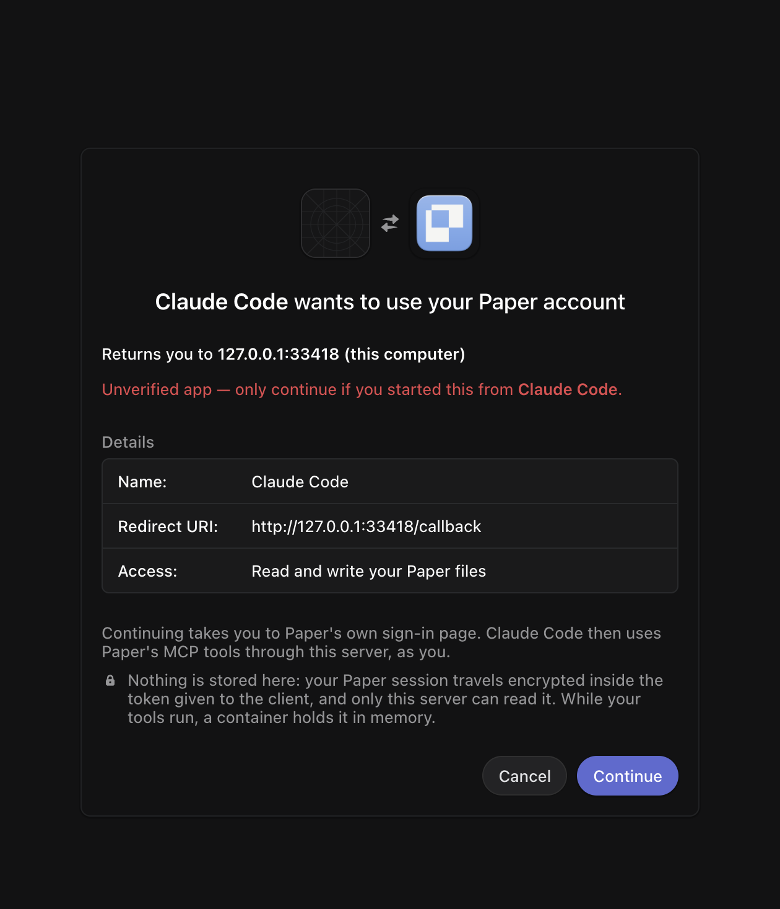
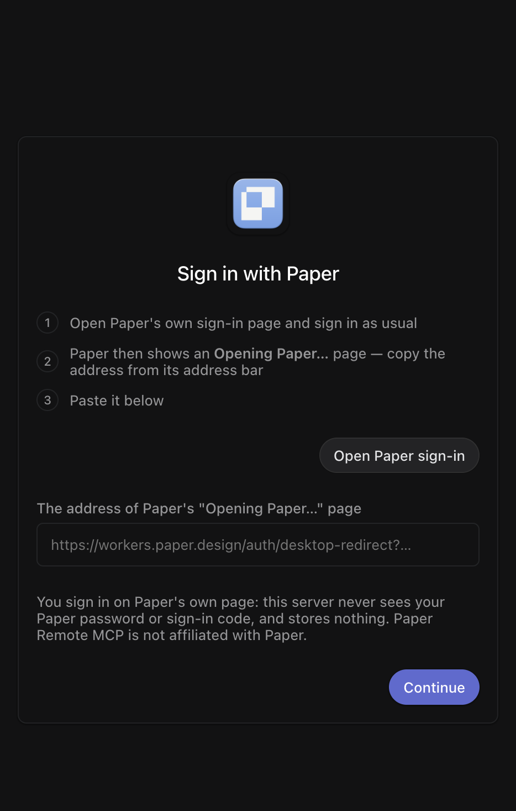

# paper-remote-mcp

Run [Paper](https://paper.design)'s MCP server without the desktop app — hosted, or on your own machine.


## Connect to a hosted server

```bash
claude mcp add --transport http paper https://<your-server>/mcp
```





### How signing in works

1. Your client opens the consent page → **Continue**.
2. **Open Paper sign-in** — sign in on Paper's own page, as usual.
3. Paper shows an **Opening Paper…** page. Copy its address from the address bar (⌘L ⌘C) and paste it back.
4. Done — your client gets a token and stays connected (it refreshes itself).

No Paper password or emailed code ever touches the server. The link you paste is a one-time code, exchanged with Paper over PKCE — the same flow Paper Desktop uses.

## What's true of the server

- **Nothing is stored.** No database, no token logs. Everything handed out is AES-256-GCM ciphertext under one `SEAL_KEY`; the session travels inside the client's tokens (~3 KB).
- **Refreshes are automatic.** Access tokens live 1 h, refresh tokens 30 days; every refresh asks Paper you're still signed in and folds in Paper's cookie renewals.
- **Revoking = signing out in Paper.** Takes effect within the hour.
- Tools run Paper's own live bundle: a lite engine for most calls, Chromium only for the ~8 layout tools (screenshot, export, computed styles, …).
- Paper's meter is mocked in the container: `/meter/balance` answers full (`mcpCap: 10000`) and `/meter/record-mcp` is dropped — the weekly-limit gate never trips.

## Host it yourself

**Any Docker VM** (free; one Paper account per server):

```bash
docker build -f Dockerfile.deploy -t paper-remote-mcp .
docker run -d --restart=always -p 127.0.0.1:8081:8080 \
  -e SEAL_KEY=$(openssl rand -base64 32) -e PUBLIC_URL=https://paper.example.com \
  paper-remote-mcp
```

Put your reverse proxy or tunnel (TLS) in front at `paper.example.com`. One Paper account per server — for you, or each teammate's own.

**Cloudflare** (multi-user): needs Workers Paid for Containers.

```bash
cd remote && npm install
npx wrangler secret put SEAL_KEY   # openssl rand -base64 32
npx wrangler deploy
```

Architecture and contract: [docs/remote-runtime.md](docs/remote-runtime.md).

## Or run it locally

```bash
npx paper-remote-mcp login    # one-time sign-in in a browser window
npx paper-remote-mcp doctor   # browser ✓ sign-in ✓ tools ✓
claude mcp add paper -- npx -y paper-remote-mcp mcp
```

Other clients, same idea:

- **Cursor** — `~/.cursor/mcp.json`: `{ "mcpServers": { "paper": { "command": "npx", "args": ["-y", "paper-remote-mcp", "mcp"] } } }`
- **Codex** — `~/.codex/config.toml`: `[mcp_servers.paper]` with `command = "npx"`, `args = ["-y", "paper-remote-mcp", "mcp"]`
- **VS Code** — `.vscode/mcp.json`: `{ "servers": { "paper": { "type": "stdio", "command": "npx", "args": ["-y", "paper-remote-mcp", "mcp"] } } }`

| Command           | What it does                                              |
| ----------------- | --------------------------------------------------------- |
| `mcp` _(default)_ | Start the stdio MCP server backed by a headless editor.   |
| `login`/`logout`  | Sign in, or delete the saved session.                     |
| `doctor`          | Check Node, browser, sign-in, and tool availability.      |
| `relay`           | Forward stdio to a _running_ Paper Desktop (no CLI needed). |

Handy flags: `--file <id|url>` (open a file on start), `--env staging`, `--profile <dir>`, `--headful`.

The local server injects a no-op `navigator.modelContext` so Paper builds its real tool handlers in a headless Chrome page, then maps `tools/list`/`tools/call` onto them. The tool list comes from Paper itself, so it tracks Paper's updates.

### Local notes

- One file open at a time; switching files costs a page reload.
- It uses its own Chrome profile (Chrome locks one profile per process), saved under `~/.paper-mcp/profiles/`.
- It depends on Paper's web internals; if Paper changes them, `doctor` will say so.

## Programmatic API

```js
import { createEditorHost } from 'paper-remote-mcp';

const host = await createEditorHost({ fileId: '…' });
await host.start();
const result = await host.handleToolCall('agent-1', 'get_basic_info', {}, { name: 'my-app' });
await host.close();
```

## Development

```bash
git clone https://github.com/vcashwin/paper-remote-mcp && cd paper-remote-mcp
npm install && node src/cli.js doctor
npm test && npm run typecheck   # worker tests; typecheck incl. runtime/
node --test runtime/server.test.js runtime/lite.test.js
```

> Community project. Not affiliated with or endorsed by Paper. MIT © vcashwin
