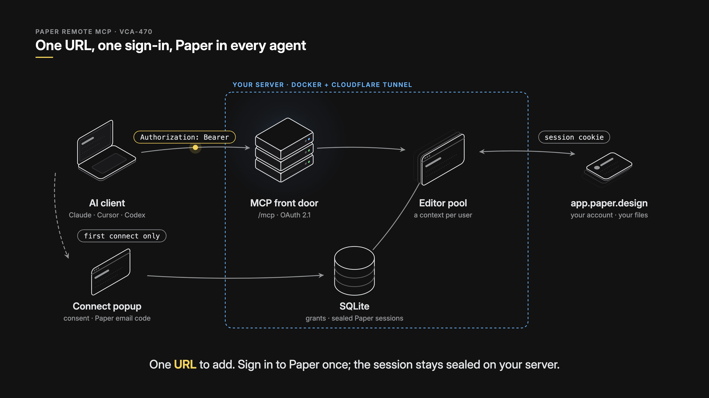

# Remote paper-remote-mcp: parity with Linefold's MCP (VCA-470)



**Goal:** a user adds one URL (`https://paper-mcp.<domain>/mcp`) to Claude, Cursor, Codex or ChatGPT. A popup asks them to
sign in to Paper once, and every agent gets Paper's own tools with no local install. This copies Linefold's MCP
(`linear-re/app/sync-server/mcp`, ADR 0038) with one change: hop 2 cannot be "OAuth to Paper", because Paper has no OAuth
for third parties.

## What we measured (2026-11-08)

| Question | Finding | Consequence |
|---|---|---|
| Can a third party use Paper's sign-in redirect? | `api.paper.design/auth/sign-in?final_redirect_uri=` takes `*.paper.design` and `paper://`. Anything else, `localhost` included, gets `?error=invalid_final_redirect_uri`. | A real "Sign in with Paper" OAuth or a `gh auth login`-style loopback is impossible today. We have to hold the session ourselves. |
| What is a Paper session? | One httpOnly sealed WorkOS cookie on `.paper.design`, rolling expiry of about 30 days. | It is portable. `fetch` with only that cookie gets `/auth/me` → 200 (user, team, plan). `browser.newContext({ storageState })` → 200. |
| Does headless Chrome reach the sign-in page? | Yes. `login.paper.design` (WorkOS AuthKit) renders "Continue with email" and "Continue with Google" with no bot wall. | The server can drive the email-code sign-in on the user's behalf. |
| Paper's own MCP | Desktop only (stdio or `127.0.0.1:29979`). It answers 404 on OAuth well-knowns. | Nothing official to proxy. We host the editor, as the local `mcp` mode already does. |

## Architecture

Linefold's front door is kept as it is. Only the far side of hop 2 changes.

```
AI client ──Bearer──▶ /mcp (stateless Streamable HTTP)
   │                     │ token → grant → paper_account
   │ first connect only  ▼
   └─▶ /authorize ──▶ Link Paper ──▶ sealed storageState (SQLite, AES-256-GCM)
                                         │ rehydrate on demand
                                         ▼
                          Editor pool: one Chromium, a BrowserContext per account
                                         │ WebMCP shim → window.mcpHandlers
                                         ▼
                                   app.paper.design
```

### 1. Front door (hop 1): port of Linefold's `frontDoor.ts` + `clients.ts`
- `/.well-known/oauth-protected-resource[/mcp]` and `/.well-known/oauth-authorization-server`.
  - Metadata advertises `client_id_metadata_document_supported: true`, `token_endpoint_auth_methods_supported` including
    `none`, S256 only, and `authorization_response_iss_parameter_supported: true`.
  - This combination makes Claude use its hosted Client ID Metadata Document instead of Dynamic Client Registration.
- `POST /register` for DCR, for clients that still need it. CIMD fetches are limited to public IPs, 5 KB and 5 s.
- Loopback redirect URIs match on any port, so Claude Code's `http://localhost/callback` works.
- `/authorize`:
  - The request travels as HMAC-signed `state` and the form is protected by CSRF.
  - PKCE S256 and `resource` (RFC 8707) are required.
  - The redirect carries `code`, `state` and `iss`.
- `/token`:
  - Grant types: `authorization_code` and `refresh_token`.
  - Rotation keeps the previous refresh token valid until its successor is used.
  - RFC 7009 revocation ends the grant.
- Tokens are opaque (`pmcp_<grant>_<rand>`) and stored as SHA-256 only. Access tokens last 24 h; refresh tokens don't expire.
- 401 challenge: `Bearer resource_metadata="…/.well-known/oauth-protected-resource/mcp", scope="paper"`.
- A single scope, `paper`, for now. Paper's tools don't split into read and write cleanly; add a split when someone needs one.
- **Personal keys** for clients without OAuth, CI and Linefold agent sessions, matching Linefold's `lin_api_` keys:
  - A signed-in `/account` page mints `pmcp_key_…` bound to the linked Paper account.
  - Usage: `claude mcp add --transport http paper https://…/mcp --header "Authorization: Bearer pmcp_key_…"`.

### 2. Link Paper (hop 2): where we differ from Linefold
After consent, `/authorize` checks for a first-party `__Host-pmcp_account` cookie whose Paper session still returns
`/auth/me` → 200. If it finds one, the user approves with **one click**. Otherwise it shows one of the link methods below
and then issues the code. Each method produces the same thing: a sealed `storageState` plus the Paper user id from
`/auth/me`, which is the account key.

| Method | UX | Covers | Build |
|---|---|---|---|
| **Sign in through the server (default)** | "Paper email" → whatever Paper asks next: "Paper password" and/or "the code Paper just sent you" (email verification, MFA), with Paper's own error text. | Email and password accounts. | A headless context opens `api.paper.design/auth/sign-in` and fills each step. After each step it waits for `/auth/me` → 200, a password field, a one-time-code field, an error line, or a non-Paper host (Google, SSO), which means "use the other method". |
| **Link from this computer** | The page shows `ABCD-EFGH` and `npx -y paper-remote-mcp link ABCD-EFGH --server …`. The page continues by itself. | Google and SSO accounts, and anyone already signed in with local `login`. | `link` reads the local `login` profile's session (running `login` first if needed) and POSTs it to `/link/code/<code>`. The code is single-use, lasts 10 minutes, and only the browser holding its poll secret receives the account. |
| Live window (only if the first two fall short) | A screencast of a server-side Chromium inside the popup. | Password, SSO, CAPTCHA. | CDP `Page.startScreencast` plus input forwarding. Deferred. |
| Paper OAuth (the long-term swap) | "Sign in with Paper". | Everyone. | Only if Paper allowlists our redirect or ships PATs. It becomes Linefold's two hops exactly; nothing else changes. |

If a session expires mid-use (Paper answers 401), we mark the account unlinked and answer `401 invalid_token`. The client
then re-runs OAuth, which re-runs Link, so the client heals itself with no support ticket.

### 3. Editor pool (refactor of `src/editor/host.js`)
- `createEditorHost` takes a `BrowserContext` instead of a profile directory. Local `mcp` passes its persistent context;
  `serve` passes `browser.newContext({ storageState: unseal(row) })`.
- One shared Chromium. Each account gets its own isolated context (separate cookie jar), created on first call.
  - Eviction: LRU with a 10-minute idle TTL, and a cap based on RAM (roughly 250–400 MB per warm editor).
  - Before closing, `storageState()` is written back so Paper's rolling cookie refresh is kept.
- A mutex per account serialises tool calls, because the editor is one page. The existing `ensureFile` routing stays.
- `tools/list` is cached per Paper `version.json` (the catalogue is the same for every user), so listing doesn't start a
  browser. The first tool call costs a 3–5 s cold start; after that it's warm.

### 4. Transport
- Stateless Streamable HTTP on `node:http`, with the SDK's `StreamableHTTPServerTransport` and
  `sessionIdGenerator: undefined`, one per request.
- MCP 2026-07-28 removes sessions, so stateless is also the future-proof choice. File state lives in the pool keyed by
  account, not in a protocol session.
- `/healthz` for the tunnel.

### 5. Storage and secrets
- `node:sqlite` (built into Node 22.5+, no new dependency).
- Tables: `clients`, `grants`, `access_tokens`, `paper_accounts` (sealed `storageState`, paper user id, email, linked_at,
  last_ok_at), `link_codes`, `api_keys`.
- `PAPER_MCP_SEAL_KEY` (AES-256-GCM, required in `serve`) and `PAPER_MCP_URL` (canonical resource and issuer).
- Move to Postgres only when we run more than one box.

### 6. Deploy (same pattern as Linefold)
- One Docker image on the `mcr.microsoft.com/playwright` base, run with `paper-remote-mcp serve`, on the existing EC2 box
  behind a Cloudflare Tunnel at `paper-mcp.<domain>`.
- A volume for the SQLite file. Cloudflare WAF limits `/register` and `/link/*`.
- Client docs at `GET /` match Linefold's `docs/mcp.md`:
  - Claude Code: `claude mcp add --transport http paper https://…/mcp`
  - claude.ai: Connectors › Add custom connector
  - Cursor and VS Code: `{ "url": … }`
  - Codex: `mcp-remote` for stdio-only clients.

**Measured during the build (2026-11-08):**
- Paper's "Continue with email" leads to a **password** page; no email code was offered. So the in-browser link follows
  whatever step Paper shows, instead of assuming a code.
- Two copies of one Paper session renew independently. The local profile renewed its cookie, and an older snapshot of the
  same session still worked afterwards and renewed itself too. So `link` can safely share the local session.

## File plan (as built)
```
src/remote/server.js     node:http router: /mcp (stateless SDK transport per request), well-knowns, /account, /healthz, /
src/remote/frontDoor.js  port of linear-re mcp/frontDoor.ts: metadata, /authorize, /token, /register, bearer → account
src/remote/clients.js    port of linear-re mcp/clients.ts + publicNetwork.ts: DCR, CIMD (public addresses only)
src/remote/link.js       Link Paper: sign-in jobs, link codes, the account cookie
src/remote/paper.js      the Paper seam: validate, signIn (step machine), editor pool (config, call)
src/remote/accounts.js   accounts + sealed sessions
src/remote/store.js      node:sqlite schema
src/remote/seal.js       HKDF-derived AES-256-GCM sealing, HMAC signing, digests
src/remote/pages.js      consent / link / account / setup HTML (no framework)
src/remote/serve.js      env → server; src/remote/linkCli.js  `link <CODE>`
src/editor/host.js       accepts a BrowserContext (remote) or launches the profile (local, unchanged)
test/remote.test.js      12 HTTP-level tests with a fake Paper, incl. the real MCP SDK client's OAuth flow
```

## Phases (tracked as VCA-471 → VCA-472…477; all built on this branch)
1. **Spike (1–2 days).**
   - Drive the email code end to end, including a Google-created account.
   - Confirm a cookie sealed on this Mac works from the EC2 IP (not IP-bound).
   - Measure per-context RAM and cold start.
2. **Remote with keys.** `serve`, the pool, `link <code>`, personal keys. Claude Code and Cursor work by URL plus header,
   which is the quickest useful remote.
3. **OAuth front door + email-code popup.** claude.ai connectors, Claude Code and Cursor work with no header.
   Port the 18 front-door tests.
4. **Deploy + docs + revoke UI.** Run Linefold's `check-mcp-clients` against it.
5. Live-window fallback or Paper OAuth, only when needed.

## Risks and things to settle first
- **The meter mock.** `mandatoryInstallScript` in `src/editor/host.js` fakes Paper's `/meter/balance` on every run,
  including in remote mode. It was kept as-is by the owner's decision (2026-11-08).
- **Trust.** The hosted server holds live Paper sessions and receives Paper passwords and codes while linking. To limit the exposure:
  - Seal sessions at rest and never log cookies, passwords or codes.
  - Keep each account in its own context.
  - "Disconnect" deletes the sealed session. Paper's own "sign out everywhere" kills it upstream.
  - Start as a personal or self-hosted instance. Ask Paper for a sanctioned OAuth client before opening it to the public
    or submitting to the Claude connector directory. Their answer replaces hop 2 with real OAuth.
- **Fragility.** We depend on the AuthKit page markup and Paper's WebMCP bootstrap. `doctor` already checks the bootstrap;
  add a `/healthz?deep=1` that signs in a canary account daily.
